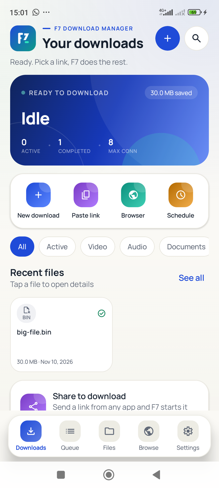
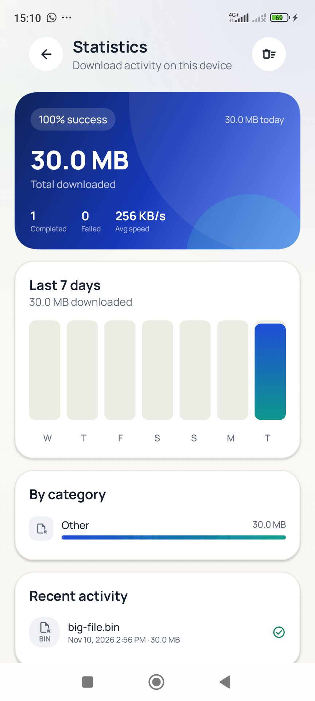
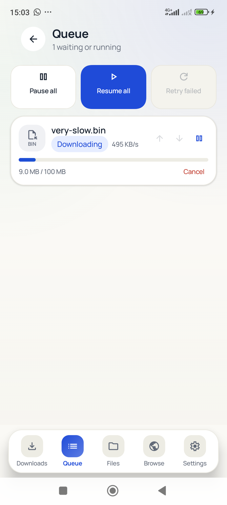
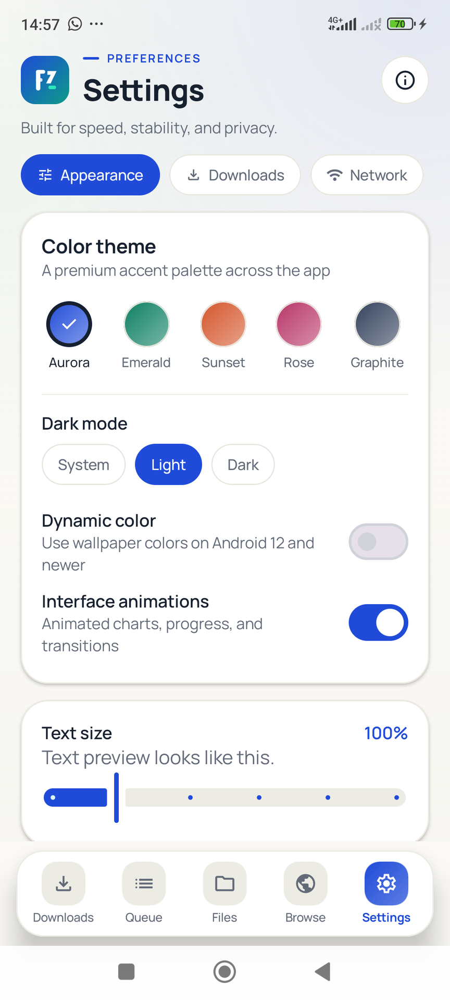
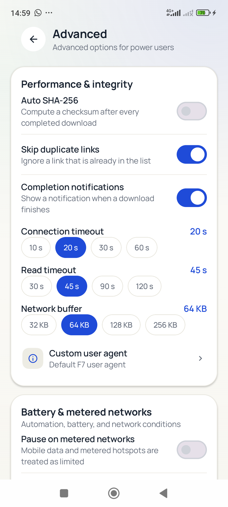
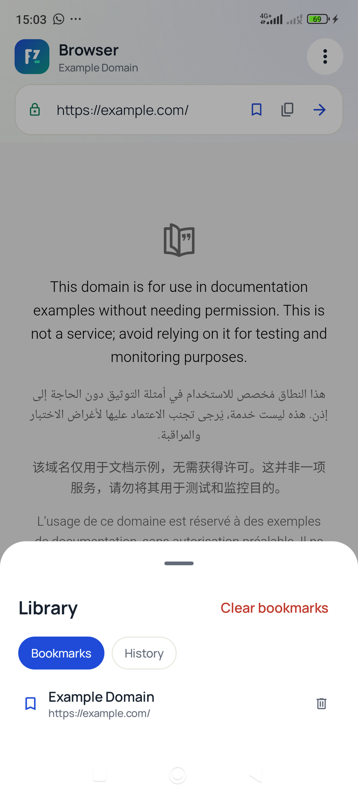

# F7 Download Manager & Browser

A modern, lightweight Android download manager built natively with Kotlin and
Jetpack Compose. No account, no server, no ads, and no paid API.

**Status:** **1.1.0** release APK/AAB builds successfully; 17 JVM tests pass. Core download
paths were verified end-to-end on an Android 15 emulator (fresh, pause, force-stop resume,
connection drop, network loss, HLS, AES-128 HLS) and on a physical Redmi Note 11 / Android 13
(30 MB fresh download with an exact SHA-256 match, queue pause/resume, browser bookmark/library,
statistics, advanced settings, and a live v1 → v3 Room migration). SAF, exact timed alarms, and
speed-limit accuracy are implemented but not yet fully device-verified — see
[docs/TEST_REPORT.md](docs/TEST_REPORT.md). The app does not claim unmeasured speed improvements;
the dashboard displays live measured throughput only.

## What's new in 1.1.0

- **Statistics dashboard** — real completed/failed counts, success rate, bytes, average throughput,
  seven-day chart, category breakdown, recent activity, and clear-stats.
- **Priority queue** — dedicated fifth tab, move items up/down, pause/resume all, retry failed,
  and a per-item cancel.
- **Advanced settings** — auto SHA-256 after completion, duplicate-link skipping, timeouts,
  network buffer, custom user agent, completion notifications, metered/battery-saver/charging/low
  battery rules, auto-delete, browser JavaScript/cookies/desktop mode/search engine/homepage,
  export settings, reset, and cleanup tools.
- **Browser library** — persistent bookmarks and history, bookmark toggle in the address bar,
  search-engine choice, desktop UA, and clear browsing data.
- **Material You + motion** — optional dynamic color on Android 12+, animation toggle, branded
  splash screen, and refreshed Play screenshots.
- **Engine hardening** — priority scheduling, accurate start-based throughput stats, configurable
  HTTP timeouts/buffer, temporary-condition auto-pause with power/network broadcast recovery,
  and DB v3 migration.


## Screenshots

| Downloads | Statistics | Queue |
| --- | --- | --- |
|  |  |  |

| Settings | Advanced settings | Browser library |
| --- | --- | --- |
|  |  |  |

Play-sized (864×1920) copies are in `docs/play-assets/screenshots/`; full-resolution captures
are in `docs/screens/1.1/`.

## Features that are actually implemented

- **Segmented HTTP/HTTPS downloads** — 1–16 parallel Range connections, adaptive
  connection growth/shrink based on measured throughput, configurable 32–256 KB streaming writes,
  no whole-file buffering.
- **Reliable resume** — segment offsets/byte counts persisted in Room roughly every
  second; pause, process death, and app restart resume from the stored byte offset.
  ETag/size changes force a clean restart to avoid corrupt files.
- **Retry and auto-recovery** — per-segment exponential backoff, configurable
  attempt limit, automatic recovery when the foreground service restarts, network
  loss handling, Wi-Fi-only waiting.
- **Foreground service** — `dataSync` foreground service with progress
  notifications, pause/resume/cancel actions, wake lock, and Android 15 timeout
  handling.
- **HLS / M3U8 (VOD, non-DRM)** — master playlist variant selection, TS and fMP4
  init segments, AES-128 segment decryption, resume at segment boundaries. TS
  output uses `.m2ts` so MediaStore does not append a second extension. Live
  playlists, SAMPLE-AES/DRM, key rotation, and alternate audio renditions are
  rejected with an explicit message.
- **Integrated browser** — WebView with JavaScript enabled for sites but no local
  file access, no JavaScript bridge, mixed content blocked, SSL errors rejected,
  popups blocked. Download listener captures links and forwards cookies, referer,
  and user agent. Android Share and clipboard intake are supported.
- **Priority queue and batch** — configurable concurrent downloads, reorderable priority queue,
  pause/resume all, retry failed, multiple URLs per add operation, one-time/daily/weekly schedules
  with an inexact
  `AlarmManager` alarm and a notification fallback when Android blocks a
  background foreground-service start.
- **Speed limit and network rules** — process-wide token bucket, Wi-Fi only, metered-network
  pause, battery-saver pause, charging-only, and low-battery pause, with broadcast-driven recovery.
- **Storage** — MediaStore Downloads (`Download/F7`), app-specific storage, or any
  folder through the Storage Access Framework with persisted permission.
  Random-access writes via `FileChannel` at byte offsets.
- **File tools** — open/share, category filters, duplicate detection by name+size,
  SHA-256 checksum, optional automatic SHA-256, delete, path copy.
- **UI** — English-only interface, premium light mode by default, five themes plus optional
  Material You dynamic color, dark/system modes, large default type, responsive layouts, compact
  dashboard, five-tab navigation, statistics, dedicated queue, and advanced settings.
- **Browser tools** — bookmarks, history, search-engine choice, desktop user agent, cookie and
  JavaScript toggles, and a library sheet.
- **Privacy** — no analytics, no advertising SDK, no account, no F7 relay server.

## Not implemented (deliberately, no fake buttons)

| Feature | Reason |
| --- | --- |
| Torrent / magnet | Would require a native BitTorrent engine, significantly larger APK/AAB, and a different background policy. Not included. |
| Live HLS / DRM / SAMPLE-AES | Out of scope for a non-DRM downloader; clearly rejected at runtime. |
| FTP/SFTP | Not part of the MVP. |
| Multi-audio HLS renditions | Master playlists are downloaded as the selected video variant only. |

## Architecture

```
app/                     Compose UI, navigation, ViewModels, app wiring
core/model/              Pure Kotlin models, formatting, filename logic
core/data/               Room, DataStore, repositories, storage targets
core/download/           Download engine, HLS, notifications, service, scheduler
core/ui/                 Theme, design system, reusable components
```

- **Database is the source of truth.** Any row left in an active state after a
  process death is resumed by the engine when the service starts.
- **Storage targets** abstract app files, MediaStore, and SAF and expose
  positional writes, truncation, and size validation.
- **Download engine** owns the queue, concurrency, network rules, speed governor,
  and live stats. UI observes Room plus a live-stats `StateFlow`.
- **Service** starts foreground immediately, hosts the engine, updates
  notifications, holds a wake lock, and stops when no work remains.

More detail: [docs/ARCHITECTURE.md](docs/ARCHITECTURE.md).

## Build

Requirements:

- JDK 17
- Android SDK platform 36 and build-tools 36.0.0
- The included Gradle 8.14.3 wrapper (or Android Studio)

```bash
# local.properties
sdk.dir=/path/to/Android/Sdk

# debug
./gradlew :app:assembleDebug

# release (needs keystore/keystore.properties)
./gradlew :app:assembleRelease :app:bundleRelease
```

On Windows use `gradlew.bat` instead of `./gradlew`.

Signing uses `keystore/keystore.properties`. **The keystore in this working copy is
a development upload key. Generate a new one and store it securely before
publishing a production release**; losing it means you cannot update the app
without Play App Signing key reset.

Outputs:

- APK: `app/build/outputs/apk/release/app-release.apk`
- AAB: `app/build/outputs/bundle/release/app-release.aab`
- Play icon/feature graphic/screenshots: `docs/play-assets/`
- Final delivery folder: `../dist/F7DownloadManager-1.0.0/`

## Tests

JVM unit tests (segment planning, HLS parser, filename/MIME logic):

```bash
./gradlew :core:model:testDebugUnitTest :core:download:testDebugUnitTest
```

End-to-end test server with Range, throttling, forced connection drops, HLS, and
AES-128 HLS:

```bash
python scripts/testserver.py 8080
adb reverse tcp:8080 tcp:8080
# The AES-128 HLS endpoints also need: pip install pycryptodome
```

Device verification is described in [docs/TEST_REPORT.md](docs/TEST_REPORT.md).
The test server must not be exposed to the public internet.

## Benchmark policy

No speed numbers are advertised. The app shows measured live speed from its own
byte counters. To benchmark fairly, use the bundled test server, a fixed file
size, the same device/network, and compare like-for-like settings. Any claim in
documentation must be reproducible from the included scripts.

## License and source

F7 Download Manager is free software licensed under the **GNU General Public
License, version 3 or later** (`LICENSE`).

It is an original Kotlin implementation inspired by the feature set of **Mister
Download Manager** (GPL-3.0, Rust desktop). No source code from that project is
used. See `NOTICE.md` for attribution and third-party licenses.

Because GPL-3.0 requires source availability, ship the complete source tree
(including this repository, build files, and resources) together with any APK/AAB
you distribute, or provide a written offer valid for three years. The About screen
states this.

## Google Play

AAB is ready for upload after you:

1. host the privacy policy (`docs/privacy-policy.html`) and enter its URL;
2. complete Data safety using [docs/PLAY_CHECKLIST.md](docs/PLAY_CHECKLIST.md);
3. add screenshots (device screenshots are pending; see the test report);
4. replace the development upload key.

There are no ads, no trackers, no account system, and no dangerous permissions
beyond the notification permission prompt on Android 13+.

## Limitations and security notes

- Cleartext HTTP is allowed because download managers must support HTTP links; the
  UI warns before starting one. Prefer HTTPS.
- Resume requires server support for Range. Servers without Range restart from zero.
- MediaStore/SAF resume depends on the provider supporting seekable file descriptors.
- Schedules are inexact and Android may defer them in Doze; background
  foreground-service starts may be blocked, in which case the app posts a
  notification to start the download.
- Live HLS, DRM-protected content, and torrents are not supported.
- The browser is a general-purpose WebView and can access third-party sites; its
  security configuration is documented in `docs/SECURITY.md`.


